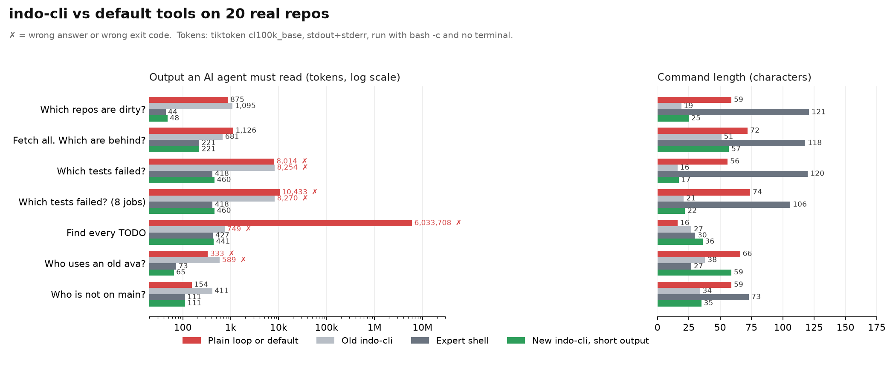

# indo-cli vs default tools: a benchmark on 20 real repos

**Headline.** With the new short output (`-c`, `-f`), indo-cli gave the right answer *and* the right exit code in 7 of 7 tasks. The output was 93% smaller than plain shell loops and 93% smaller than the old indo-cli. Expert shell one-liners are about as small (6% fewer tokens), but their commands are 2.6 times longer and easy to get wrong.

| Task (20 repos) | Plain loop | Old indo-cli | Expert shell | **New indo-cli** | New indo-cli command |
|---|---|---|---|---|---|
| Which repos are dirty? | 875 tok | 1,095 tok | 44 tok, 121 chars | **48 tok, 25 chars** | `indo -c * 'git status -s'` |
| Fetch all. Which are behind? | 1,126 tok | 681 tok | 221 tok, 118 chars | **221 tok, 57 chars** | `indo -c -P 8 * 'git fetch -q && git status -sb \| head -1'` |
| Run tests. Which failed? | 8,014 tok ✗ | 8,254 tok ✗ | 418 tok, 120 chars | **460 tok, 17 chars** | `indo -f * ./ci.sh` |
| Same, 8 jobs in parallel | 10,433 tok ✗ | 8,270 tok ✗ | 418 tok, 106 chars | **460 tok, 22 chars** | `indo -f -P 8 * ./ci.sh` |
| Find every TODO | 6,033,708 tok ✗ | 749 tok ✗ | 427 tok, 30 chars | **441 tok, 36 chars** | `indo -c * 'git grep -n TODO \|\| true'` |
| Who uses an old `ava`? | 333 tok ✗ | 589 tok ✗ | 73 tok, 27 chars | **65 tok, 59 chars** | `indo -c * 'grep "\"ava\"" package.json 2>/dev/null \|\| true'` |
| Who is not on main? | 154 tok | 411 tok | 111 tok, 73 chars | **111 tok, 35 chars** | `indo -c * git branch --show-current` |

`tok` = tokens of output (stdout and stderr) that an AI agent has to read. ✗ = wrong answer or wrong exit code. "Plain loop" is what people and agents usually type first (`for d in */; do ...; done`, `xargs -P`, `grep -rn`). "Expert shell" is the best default tool we found for that task. All commands and outputs are in [`bench/outputs/`](bench/outputs/).

## What the numbers say

**1. The old indo-cli could not tell you that something failed.** It always ended with the exit code of the *last* folder. In the test task, 4 of 20 repos failed and it still returned 0. In parallel mode the output of different folders was mixed together, so even a careful reader blamed the wrong repo (`pretty-bytes` instead of `errors`).

**2. `in` does not run in Bash at all.** `in` is a reserved word in Bash and sh. `bash -c 'in * pwd'` stops with `syntax error near unexpected token 'in'`. AI agents run every command through `bash -c`, so for agents the old tool did not exist. The installer now uses `indo` by default.

**3. Test output is where tokens explode.** One test run over 20 repos printed about 8,000 tokens. Most of it is "ok" noise from passing repos. `indo -f` prints only the failed repos, the last 10 useful lines of each (stack frames skipped), and one count line: `16/20 ok, 4 failed: errors slugify tldr-python-client toolz`. That is 460 tokens, 94% less, and it exits with 1.

**4. Plain tools have quiet traps.**
- `find ... -execdir git status \;` from the old README runs in the *parent* folder. It printed 20 times `fatal: not a git repository` and exit code 0.
- `find -exec` returns 0 even when the command failed.
- `xargs ... | sed` hides the exit code of the test command.
- `grep -rn TODO */` read `node_modules` and printed 6 million tokens.
- `rg TODO` skips hidden files by default, so it missed 5 of 17 TODOs (in `.macos`, `.vim/` and `.github/`). `rg --hidden -g '!.git'` finds all 17.

## Where indo-cli wins

- **Short commands that are also correct.** 17 to 59 characters, against 73 to 121 for the expert loops. Less to type, less to get wrong, and fewer tokens in the agent's own command.
- **Exit codes you can trust.** 0 only when every folder worked. Otherwise 1, plus `N of M folders failed: a b c`.
- **Failures first.** `-f` shows only what broke. `-s` adds one `ok` line per folder with its last line of output (for example `ok   six: 184 passed, 16 skipped in 0.19s`).
- **Parallel output that reads like sequential output.** Each folder's output is printed as one block, in folder order. GNU parallel needs `-k` for this, and plain `xargs -P` cannot do it.
- **Safe defaults for scripts and agents.** No color codes when the output is not a terminal. Color codes that a tool forces anyway (pytest does this when `FORCE_COLOR` is set) are removed in the captured modes.

## Where default tools win

Be honest about these:

- **A single search.** `grep '"ava"' */package.json` is shorter (27 characters) than any indo-cli command. `rg` is the right tool for "search all the code". indo-cli does not try to replace them.
- **Expert loops use about 6% fewer tokens.** indo-cli adds a count line and the folder name on each line. If you are an expert and you write the loop every time, you get the same result.
- **GNU parallel is the strongest rival.** `parallel -k --tag` keeps order, tags lines and returns the number of failures. It is just harder to remember, and its plain output was 10,699 tokens on the test task.
- **Raw speed.** indo-cli's short output modes write each folder's output to a temp file first. On 20 folders that costs about 0.1 seconds (0.15 s instead of 0.04 s for a plain loop). For anything real (tests, fetch, builds) this does not matter. `-P 8` ran the tests in 9.5 s instead of 22 s.
- **Commands whose "failure" is not a failure.** `grep` exits 1 when it finds nothing. indo-cli reports this as a failed folder. You need `|| true` for search commands. Without it, the `ava` task printed 451 tokens of `FAIL` lines instead of 65.

## For humans

- The new default (human) mode looks the same as before. It now adds a red `✘ repo: exit N` line under a failed folder and a summary line at the end.
- `indo * cmd` is still the shortest way to type "run this in every folder".
- New flags are short and easy to remember: `-c` compact, `-s` summary, `-f` failures only, `--tail N`, `--no-color`, `-V`.

## For AI agents

Use these rules (good for a Claude Code skill or an `AGENTS.md`):

1. Call `indo`, never `in`.
2. Status questions: `indo -c * 'git status -s'`. Empty folders are skipped.
3. Tests and builds: `indo -f -P 8 * 'npm test'`. Read the exit code, then only the failed folders.
4. Search commands need `|| true`, for example `indo -c * 'git grep -n TODO || true'`.
5. To search all code once, use `rg --hidden -g '!.git'` instead.

## How we measured

- **Workspace.** 20 real open source repos, cloned from GitHub: 6 JavaScript (sindresorhus), 5 Go, 6 Python, and 3 without tests (gitignore, awesome-nodejs, dotfiles). Real test suites run through one `ci.sh` per repo. 4 repos fail for real reasons: a `go vet` error in new Go, missing package metadata, a missing dependency, and one bug we added. 6 repos are dirty, 5 are behind their remote, 2 are ahead, 1 is on a feature branch. Remotes are local bare repos, so fetch is fast and repeatable. The script is [`bench/setup_workspace.sh`](bench/setup_workspace.sh).
- **How commands ran.** Every command ran with `bash -c`, no terminal, stdin closed. This is how AI agents run commands.
- **Tokens.** tiktoken `cl100k_base`, counted on stdout and stderr together.
- **Right answer.** A script splits the output into per-repo parts (by header line or line prefix) and checks which repos it flags as dirty, behind, failed and so on. It must match the known truth exactly. Output with no repo names (like `find -exec`) counts as wrong.
- **Right exit code.** 0 for questions where nothing is broken. Not 0 for the test tasks, where 4 repos fail.
- **Time.** Median of 3 runs. The two test tasks ran once.
- **Code.** [`bench/bench.py`](bench/bench.py), raw results in [`bench/results.json`](bench/results.json).

## Limits

- One machine (Linux, Bash 5.2, 8 cores). We did not test macOS Bash 3.2 or zsh. The code avoids Bash 4 features, but this needs a run on a Mac.
- 20 repos and 7 tasks. Bigger workspaces would make the plain loops look worse, not better.
- The token counter is an OpenAI tokenizer. Other models count a bit differently, but the ratios stay about the same.
- "Right answer" is checked by a script, not by an AI agent. A smart agent can often still find the failure in an 8,000 token dump. It just pays for every token, and it pays again on every later turn of the chat.
