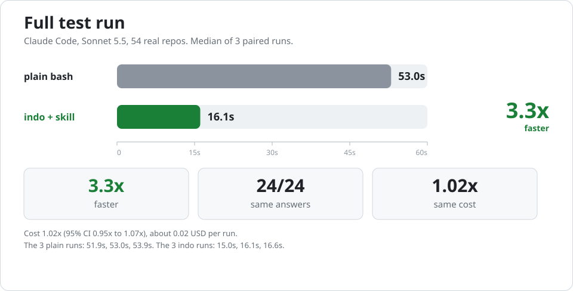
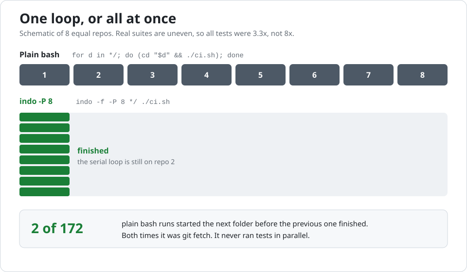
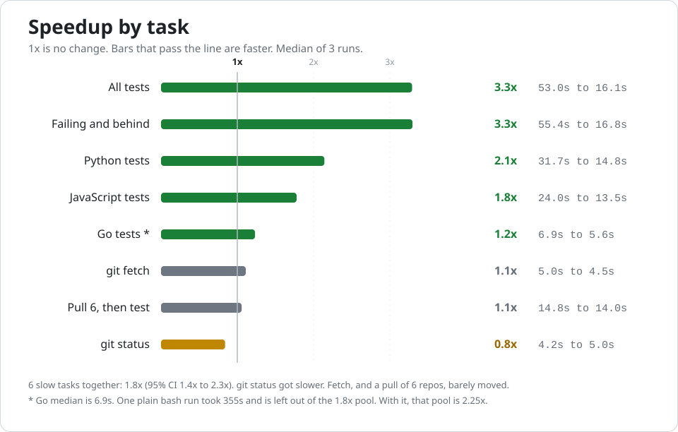
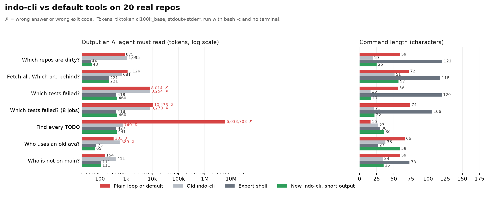

# indo

Run one command in every repo, in parallel.

**53.0 s** with a plain bash loop. **16.1 s** with indo and the Agent Skill. Same answers, same cost.

Claude Code (Sonnet 5.5) on 54 real repos. Median of 3 paired runs. [Method and raw results](bench/agent-eval/README.md). [Write-up](https://nevolin.be/blog/coding-agents-run-tests-one-repo-at-a-time).

[Install](#install) · [Quick start](#quick-start) · [For agents](#indo-for-ai-agents) · [Usage](#usage)

<picture>
  <source media="(prefers-color-scheme: dark)" srcset=".github/assets/readme/hero-dark.svg">
  <source media="(prefers-color-scheme: light)" srcset=".github/assets/readme/hero-light.svg">
  
</picture>

```bash
indo -f -P 8 * 'npm test'      # test every repo, show only what failed
```

- **One command, every folder.** No `for` loops, no `find -exec`, no `xargs` quoting.
- **Parallel.** `-P 8` runs 8 folders at a time. Output stays grouped and in order.
- **Only what broke.** `-f` prints the failed folders and one count line. 94% less output on 20 real repos.
- **Honest exit codes.** 0 only if the command worked in every folder.
- **Built for AI agents.** On 54 real repos, test tasks finished 1.8x faster and a full test run 3.3x faster. Same answers, same cost ([eval](#indo-for-ai-agents)).
- **Zero dependencies.** One Bash script. Bash 3.2 or newer.

## Install

```bash
curl -sL https://raw.githubusercontent.com/inevolin/indo-cli/main/install.sh | bash
```

With the Agent Skill for Claude Code and Cursor (installs to `~/.claude/skills/indo`):

```bash
curl -sL https://raw.githubusercontent.com/inevolin/indo-cli/main/install.sh | bash -s -- --with-skill
```

No sudo? Install to your home folder:

```bash
curl -sL https://raw.githubusercontent.com/inevolin/indo-cli/main/install.sh | DEST_DIR=~/.local/bin bash
```

Want another name? Pass it: `... | bash -s -- mycmd`. Then only that name is installed.

`DEST_DIR` is always used as given. If the folder does not exist, the installer stops with an error and installs nothing. To create the folder instead, add `--create-dir` (or set `CREATE_DIR=1`):

```bash
curl -sL https://raw.githubusercontent.com/inevolin/indo-cli/main/install.sh | DEST_DIR=~/tools/bin bash -s -- --create-dir
```

> **Why `indo` and not `in`?** `in` is a reserved word in Bash, so `in * ls` is a syntax error there (and in `bash -c`, which AI agents use). The installer adds `indo`, plus an `in` link that works in zsh.

## Quick start

```bash
indo * git status -s                      # status of every repo
indo -c * 'git status -s'                 # only dirty repos, one line per file
indo -P 8 * git pull                      # pull everything, 8 at a time
indo -f -P 8 * 'npm test'                 # run all tests, show only failures
indo -c * git branch --show-current       # which branch is each repo on?
indo -d * 'rm -rf node_modules'           # dry run: print, do not run
```


## The problem

Many of us work in a folder full of repos. Ten services, twenty libraries, a fleet of small projects without a monorepo.

So we run the same command again and again. `git pull` here, `npm test` there. Or we write a loop:

```bash
for d in */; do (cd "$d" && npm test); done
```

The loop runs one folder at a time. It prints thousands of lines. It returns the exit code of the last folder only, so a failure in the middle is lost.

AI coding agents do the same thing. In 172 plain bash runs, Claude Code ran folders in parallel twice. Both times it was `git fetch`. It never ran tests in parallel.

<picture>
  <source media="(prefers-color-scheme: dark)" srcset=".github/assets/readme/serial-dark.svg">
  <source media="(prefers-color-scheme: light)" srcset=".github/assets/readme/serial-light.svg">
  
</picture>

indo is one short command. It runs in every folder, in parallel, and tells you only what went wrong.

## Use cases

### Tests and builds across many repos

```bash
indo -f -P 8 * 'npm test'
indo -f -P 4 packages/* 'pnpm build'
indo -s -P 8 services/* 'go test ./...'   # one ok or FAIL line per repo
```

`-f` prints nothing for the folders that passed. You get the failures and a last line like `16/20 ok, 4 failed: errors slugify tldr-python-client toolz`.

### Git across a folder of repos

```bash
indo -s -P 8 * 'git fetch -q'                                       # fetch everything
indo -c * 'git rev-list --left-right --count HEAD...@{u}'          # ahead and behind
indo -c * 'git log -1 --format=%cs'                                 # last commit date
indo -P 8 * 'git pull --ff-only'                                    # safe pull
```

### Dependency and code audits

```bash
indo -c * 'grep "\"lodash\"" package.json || true'    # who still uses lodash?
indo -c * 'jq -r .engines.node package.json 2>/dev/null || true'
indo -c * 'git grep -c TODO || true'                  # TODOs per repo
indo -c * '[ -e LICENSE ] || echo missing LICENSE'
```

### A fleet of repos without a monorepo

Keep your repos small and separate, and still work on them as one:

```bash
indo services/* "git checkout -b release/2.0 && git push -u origin release/2.0"
indo frontend,backend,worker 'docker build -t "$(basename "$PWD")" .'
indo packages/* "npm version patch && git push --follow-tags"
```

### Agent workflows

Give your coding agent indo and the Agent Skill. It then runs slow commands in parallel and reads short output. See [indo for AI agents](#indo-for-ai-agents).

More: [EXAMPLES.md](EXAMPLES.md) has 50+ examples.

## indo for AI agents

We tested indo with a real coding agent, not with scripted commands. Claude Code got the same multi-repo tasks with and without indo. Full method, scripts and every raw run: [bench/agent-eval](bench/agent-eval/README.md).

<picture>
  <source media="(prefers-color-scheme: dark)" srcset=".github/assets/readme/tasks-dark.svg">
  <source media="(prefers-color-scheme: light)" srcset=".github/assets/readme/tasks-light.svg">
  
</picture>

### What we found

On 54 real repos, Claude Code (Sonnet 5.5) with indo and the Agent Skill:

| | Plain bash | With indo |
|---|---|---|
| Correct answers | 24/24 | 24/24 |
| Run all tests in 54 repos, which fail? | 53.0 s | **16.1 s (3.3x faster)** |
| 6 slow multi-repo tasks (tests, pull then test) | 1x | **1.8x faster** (95% CI 1.4x to 2.3x) |
| Cost per run | 1x | 1.02x (95% CI 0.95 to 1.07) |
| Ran tests in parallel | never | 18 of 18 slow-task runs |

- **Same answers.** Both setups got every task right, here and in 168 earlier runs on 20 repos.
- **Faster where it matters.** Tests and builds finish faster because indo runs folders in parallel. Quick commands like `git status` gain nothing.
- **Agents do not parallelize on their own.** In 172 plain bash runs, Claude Code ran folders in parallel only twice (both `git fetch`). It never ran tests in parallel.
- **Use the skill, not a prompt note.** An always-on note in the system prompt cost 6% to 30% more per run. With the skill, cost stayed about the same.
- **A smaller model did not get faster.** Haiku 5.5 was at 0.98x the time, and it used indo in 8 of 18 runs.

### Limits

This is a small study. [Full method](bench/agent-eval/README.md#limits).

- One agent (Claude Code) and one model on the 54-repo run (Sonnet 5.5). Cursor, Codex and Gemini are not tested.
- 3 paired runs per task, on one 8-core Linux machine. The intervals are wide because the sample is small.
- One plain bash Go run stalled for 355 s. It is left out of the 1.8x figure. With it, that figure is 2.25x.
- Each repo had a `ci.sh`, so the agent did not have to find how to run the tests.

### Install the Agent Skill

The skill is one file: [skills/indo/SKILL.md](skills/indo/SKILL.md). It tells the agent when to use indo and which command to run.

| Agent | Where the skill goes | Command |
|---|---|---|
| Claude Code | `~/.claude/skills/indo/` | `install.sh --with-skill` (see [Install](#install)) |
| Cursor | `~/.cursor/skills/indo/` or `~/.agents/skills/indo/` (Cursor also reads `~/.claude/skills`) | same as Claude Code |
| Codex | `~/.agents/skills/indo/` | `curl -sL https://raw.githubusercontent.com/inevolin/indo-cli/main/install.sh \| SKILL_DIR=~/.agents/skills bash -s -- --with-skill` |
| Other agents | Agents that read `AGENTS.md` only: paste the rules below into it | |

Install the skill in one place per agent. Cursor reads both `~/.claude/skills` and `~/.agents/skills`, so two copies show up twice. For one project only, put the folder in the repo instead: `.claude/skills/indo/` (Claude Code), `.cursor/skills/indo/` (Cursor) or `.agents/skills/indo/` (Codex and Cursor).

Rules for `AGENTS.md` or `CLAUDE.md`:

```text
indo is installed. To run a command in 2 or more folders, use it instead of a for loop.
Slow commands (tests, builds, git fetch or pull): indo -f -P 8 */ 'CMD'
Status or search: indo -c */ 'git status -s'   (add || true after grep)
```

## Usage

```bash
indo [OPTIONS] [DIRECTORIES...] [--] COMMAND...
```

| Flag | What it does |
|------|-------------|
| `-P`, `--parallel N` | Run N folders at a time. Output stays grouped per folder, in order. |
| `-c`, `--compact` | Prefix each output line with the folder. Skip folders with no output. |
| `-s`, `--summary` | One line per folder: `ok` or `FAIL`. Failed folders show their last lines. |
| `-f`, `--fail-only` | Like `-s`, but only failed folders. |
| `--tail N` | Lines to show per failed folder (default 10). |
| `--color WHEN` | `auto` (default), `always` or `never`. `--no-color` and `NO_COLOR=1` also work. |
| `-d`, `--dry` | Print the commands, run nothing. |
| `-v`, `--verbose` | Debug logs. |
| `-V`, `--version` | Show the version. |
| `-h`, `--help` | Show help. |

**Exit code:** 0 if the command worked in every folder. 1 if it failed in any folder. The last line says how many failed and where.

### Rules of thumb

1. **Quote the command** if it has `&&`, `||`, `;`, `|`, `>` or a `*` meant for inside the folder: `indo * 'ls *.json'`.
2. **Use `--`** when a folder has the same name as a command: `indo * -- git status`.
3. **Use `-f`** for tests and builds. You see only the failed folders and one count line.
4. **Use `-c`** for status and search. One line per result, empty folders skipped.
5. **Add `|| true` to searches.** `grep` exits 1 when it finds nothing, and indo counts that as a failure.

### Wildcards

Your shell expands `*.txt` **before** indo runs, in your current folder.

- ❌ `indo projects/* ls *.txt` expands `*.txt` here, not inside each project.
- ✅ `indo projects/* "ls *.txt"` quotes it, so it expands inside each folder.

### Output for scripts and AI agents

On a terminal you get colors and live output. In a pipe, a file or an agent's shell, colors are off. With `-c`, `-s` and `-f`, output is captured per folder and printed as one clean block:

```text
$ indo -f --tail 3 -P 8 errors six toolz uuid ./ci.sh
FAIL errors (exit 1)
  ./errors_test.go:220:31: non-constant format string in call to github.com/pkg/errors.WithMessagef
  FAIL	github.com/pkg/errors [build failed]
  FAIL
FAIL toolz (exit 1)
  SKIPPED [1] toolz/tests/test_functoolz.py:737: annotationlib is new in Python 3.14
  FAILED toolz/tests/test_package.py::test_has_version - importlib.metadata.Pac...
  1 failed, 191 passed, 1 skipped in 0.27s
2/4 ok, 2 failed: errors toolz
```

## Benchmarks

### Agent eval

Claude Code 2.1.325 on 20 and 54 real repos (JavaScript, Go, Python), 402 graded runs in total. Three setups: plain bash, indo with a prompt note, and indo with the Agent Skill. Results above. Method, all tables and the scripts: [bench/agent-eval](bench/agent-eval/README.md).

The charts on this page are drawn from those results by [`bench/agent-eval/render_readme_charts.py`](bench/agent-eval/render_readme_charts.py). Re-run that script to regenerate the SVGs.

### Output size

We ran 7 everyday tasks on the same 20 repos, with real test suites, some failing tests and some dirty repos. Every command ran through `bash -c`, the way AI agents run commands. Full report: [ANALYSIS.md](ANALYSIS.md).



| Task (20 repos) | Plain loop | Old `in` | Expert shell | **indo short output** |
|---|---|---|---|---|
| Which repos are dirty? | 875 tok | 1,095 tok | 44 tok, 121 chars | **48 tok, 25 chars** |
| Fetch all. Which are behind? | 1,126 tok | 681 tok | 221 tok, 118 chars | **221 tok, 57 chars** |
| Run tests. Which failed? | 8,014 tok ✗ | 8,254 tok ✗ | 418 tok, 120 chars | **460 tok, 17 chars** |
| Same, 8 jobs in parallel | 10,433 tok ✗ | 8,270 tok ✗ | 418 tok, 106 chars | **460 tok, 22 chars** |
| Who is not on main? | 154 tok | 411 tok | 111 tok, 73 chars | **111 tok, 35 chars** |

`tok` = output tokens (tiktoken cl100k_base). ✗ = wrong answer or wrong exit code.

### Limits

- **Correctness did not improve.** The agent tasks were easy for the models we tested. Both arms scored the same.
- **Speed depends on the work.** The gain comes from running folders in parallel. Slow commands (tests, builds, pulls) gain the most. Quick commands gain nothing.
- **Small samples.** 3 runs per task and setup, two workspaces (20 and 54 repos), one Linux machine, one agent (Claude Code). We did not test Codex, Cursor or Gemini. One plain bash Go run stalled for 355 s and is left out of the 1.8x figure. With it, that figure is 2.25x. Haiku 5.5 got no speedup.
- **Plain tools still win sometimes.** For one search, `rg` or `grep '"x"' */package.json` is shorter. An expert loop uses about 6% fewer tokens than indo, but is 2 to 7 times longer to type. GNU parallel with `-k --tag` is just as correct, but harder to remember.

## Why not find or xargs?

Running `git status` in every subfolder:

```bash
find . -mindepth 1 -maxdepth 1 -type d -exec git -C {} status \;   # no folder names, exit code always 0
ls -d */ | xargs -I {} sh -c 'cd {} && git status'                 # no folder names
indo * git status                                                   # names, grouped, honest exit code
```

## Changelog

- **Installer fixes.** A missing `DEST_DIR` now stops the install with a clear error instead of silently installing to /usr/local/bin. New `--create-dir` flag (or `CREATE_DIR=1`) creates it. A failed download now stops with an error instead of installing an error page. A stray `in.sh` in the current folder is no longer installed by mistake. The PATH check matches whole entries only.
- **Agent Skill.** New [skills/indo/SKILL.md](skills/indo/SKILL.md), `install.sh --with-skill`, and the [agent eval](bench/agent-eval/README.md). The `indo` script did not change.
- **1.2.0** The repo is now called indo-cli (it was in-cli). The tool is `indo` everywhere. The `in` link still works.
- **1.1.0** Short output modes (`-c`, `-s`, `-f`), honest exit codes, `--version`, and `indo` as the default install name.

> **New repo name.** The repo moved from github.com/inevolin/in-cli to github.com/inevolin/indo-cli. Old links redirect here. Old installs keep working, and running the installer again updates them and keeps the `in` link.

## Uninstall

```bash
sudo rm -f "$(command -v indo)" "$(dirname "$(command -v indo)")/in"
rm -rf ~/.claude/skills/indo ~/.agents/skills/indo   # if you installed the skill
```

## Testing

```bash
./tests.sh
```

## Requirements

- Bash 3.2 or newer
- Linux, macOS, BSD, or Windows (WSL, Git Bash, Cygwin)
- No other dependencies

## Contributing

Pull requests are welcome.

## License

MIT. See [LICENSE](LICENSE).
